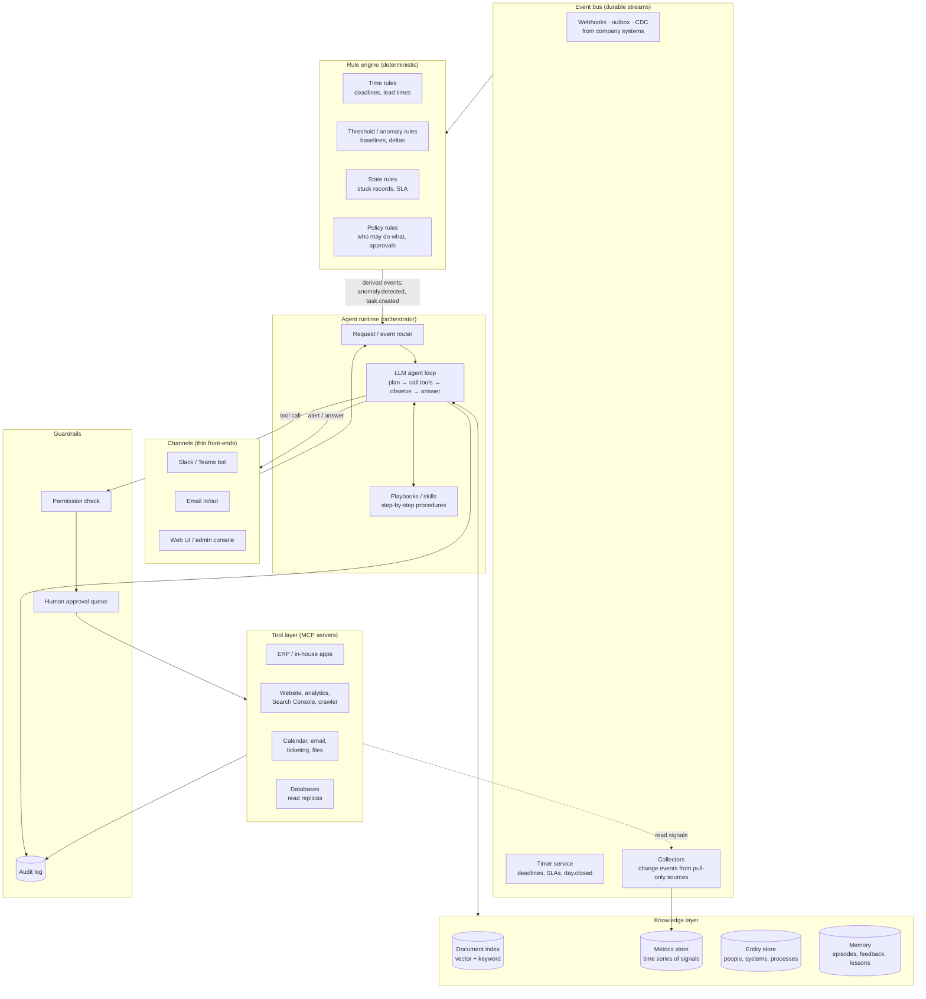

# 2. Target architecture

## 2.1 Overview

The split that makes the system trustworthy:

- **Rules** (left column) are deterministic. They decide *when* something must be
  looked at and *what the assistant is allowed to do*. They are files in git.
- **The agent** is probabilistic. It decides *how* to investigate, *which* tools to
  call, *what* to say, and it drafts the action. It never bypasses the rules.
- **Tools** are the only way the agent can touch company systems, and every tool call
  passes the guardrails.

## 2.2 Layers, one by one

### Channels

Slack/Teams bot, an email address the assistant reads and writes, and a small web
console for admins (rule editor, approval queue, audit log viewer, KB health). Channels
only carry messages; no logic lives here.

### Event bus (the backbone)

Work enters the system as **events on a durable bus**, not as cron ticks. Producers are
the company systems (transactional outbox or change data capture for in-house apps,
webhooks for SaaS), a **timer service** that turns deadlines and SLAs into
`deadline.reminder.due` events, collectors for sources that cannot push (they publish
*changes only*), and people (a button click in Slack is an event). Consumers are the
rule engine, the agent orchestrator, the notifier, the knowledge indexer, the metrics
and entity projections and the audit sink. Delivery is at-least-once with idempotent
consumers, per-key ordering, retries, a dead-letter queue and replay.

Periodic jobs remain only for **reconciliation** (compare source with projection and
publish corrections) and for sources without push. The full design, the event
envelope, the catalogue, the reliability rules and the technology choice (NATS
JetStream + Temporal recommended) are in [doc 09](09-event-messaging.md).

### Rule engine

Evaluates rules against the metrics store, entity store and incoming events. Output
is a **task** ("deadline X is in 10 days and nobody acknowledged it", "organic clicks on
/pricing dropped 42 % vs 28-day median") handed to the router with the context the rule
collected. Details in [doc 04](04-rule-system.md).

### Agent runtime

The LLM loop: receives a task or a user message, retrieves context (KB, memory,
entity store), decides whether a playbook applies, calls tools, and produces a result –
an answer, an alert, a draft action, or a completed action.

Recommended structure:

- **One orchestrator agent** that classifies the request and delegates.
- **Domain sub-agents** with a narrow tool set and system prompt each: *Knowledge
  Q&A*, *Monitoring & alerts*, *Task executor*, *Reporting*. Narrow tool sets reduce
  mistakes and make permissions simple.
- **Playbooks** – versioned markdown/YAML procedures the agent follows for known
  tasks ("monthly invoice reminder run", "SEO drop triage"). See [examples/playbooks](../examples/playbooks).

Model: Claude via the API (or Bedrock/Vertex if the company needs a specific cloud);
a self-hosted open-weight model is an option where data may not leave the premises,
at a quality cost. Keep the model behind one internal gateway so it can be swapped.

### Knowledge layer

Four stores, because four kinds of knowledge:

| Store | Holds | Technology |
|-------|-------|------------|
| Document index | chunks of the company documents with metadata and ACLs | vector DB (Qdrant, pgvector, Weaviate) + keyword index (hybrid search) |
| Metrics store | time series of every signal from discovery §1.4 | Postgres/Timescale, ClickHouse, or Prometheus for infra signals |
| Entity store | systems, people, processes, deadlines, owners, relationships | Postgres tables (optionally a graph DB later) |
| Memory | past tasks, outcomes, human corrections, lessons learned | Postgres + vector index for semantic recall |

Details in [doc 03](03-knowledge-base.md) and [doc 06](06-learning-loop.md).

### Tool layer

One **MCP server per system** (or per vendor), each exposing a small catalogue of
typed functions: `erp.get_invoice`, `erp.list_overdue_invoices`,
`erp.create_payment_reminder(dry_run=true)`, `seo.get_search_console_series`,
`crawler.diff_page`, `calendar.create_event`, `slack.post_message`. Details in
[doc 05](05-tool-system.md).

### Guardrails

- **Permission check** – every tool call is matched against policy rules: which
  agent/user may call it, with what arguments, in which environment. Read tools
  usually pass; write tools are classified *auto*, *approve*, or *forbidden*.
- **Human approval queue** – an "approve / edit / reject" card in Slack/Teams or the
  console. Approvals are recorded and feed the learning loop.
- **Audit log** – append-only record of every event, rule firing, LLM call (prompt
  hash, model, cost), tool call (arguments, result, who approved) and message sent.

### Observability and evaluation

- Tracing of every agent run (LangSmith, Langfuse, OpenTelemetry).
- A **golden evaluation set**: 50–200 questions with expected answers and sources,
  30–50 synthetic anomaly scenarios, 20 task scenarios with expected tool calls. Run on
  every change to prompts, rules or the KB.
- Dashboards: alerts fired / acknowledged / dismissed per rule, tool error rates,
  approval rates per action type, KB retrieval hit rate, cost.

## 2.3 A request end-to-end

**Scenario: the SEO example.**

0. **Push path (seconds).** The CMS publishes `cms.page.published` for `/pricing` from
   its outbox. The crawler collector re-crawls the page at once and publishes
   `crawl.page.changed` with `robots: index,follow → noindex,follow`. The pattern rule
   `seo-key-page-meta-regression` fires immediately and the agent run below starts
   before any traffic is lost. The steps that follow describe the slower, metric-based
   safety net that catches whatever has no push signal.
1. The timer service emits `day.closed`; the Search Console collector fetches the new
   day, diffs it with the last snapshot and publishes `seo.metric.collected` per page.
2. Rule engine consumes it and evaluates `seo-organic-drop` ([example](../examples/rules/seo-organic-drop.yaml)):
   clicks on `/pricing` are 42 % below the 28-day same-weekday median and the drop
   persists for 2 days → `seo.anomaly.detected` and `task.created`, severity *high*, owner *marketing*.
3. Router creates a task for the *Monitoring* agent with the rule's context attached.
4. The agent follows the `seo-drop-triage` playbook: calls `crawler.diff_page('/pricing')`
   (finds a `noindex` tag added 3 days ago), checks `deploy.list_recent()` (a CMS
   deployment 3 days ago), queries the KB ("who owns pricing page / CMS release
   process"), and composes an alert.
5. Guardrails: `slack.post_message` to `#marketing` is an *auto* action → sent.
   The agent also proposes `cms.remove_noindex('/pricing')` – a write action classified
   *approve* → an approval card goes to the page owner.
6. Owner approves; tool runs in dry-run first, then live; result and approval are logged.
7. Memory records the episode: cause = "noindex added by deployment", resolution =
   "removed tag", time to detect = 1 day. After a few similar episodes the learning loop
   proposes a new rule: "on every CMS deployment, diff robots/meta of the top 50 pages
   immediately".

**Scenario: a deadline.**

1. When the deadline was registered, the timer service armed durable timers at
   due − 10 d, − 3 d and − 1 d. The first one fires and emits `deadline.reminder.due`.
2. Time rule: `VAT return due in 10 days, status not started` → `task.created`.
3. Agent checks the KB for the VAT procedure, checks the ERP for whether the period is
   closed (`erp.get_period_status`), and sends the owner a message with the checklist, the
   current blockers, and a button "mark started".
4. If no acknowledgement in 48 h → escalation rule notifies the backup owner.

## 2.4 Deployment view

- Everything runs inside the company network (or its VPC); only the LLM API call goes
  out, with PII redaction where policy requires it.
- Components as containers: `gateway` (channels), `orchestrator`, `rule-engine`,
  `scheduler`, one container per `mcp-*` server, `postgres`, `vector-db`, `tracing`.
- Secrets in the existing vault; the assistant uses **service accounts with least
  privilege per system**, never a human's credentials.
- Separate `staging` wired to the systems' test instances; every new write tool is
  proven there first.

## 2.5 Suggested stack (opinionated, swap freely)

| Concern | Choice | Alternative |
|---------|--------|-------------|
| Agent framework | Claude Agent SDK (Python/TS) | LangGraph, Pydantic AI |
| Tools protocol | MCP | plain function calling |
| Event bus | NATS JetStream | Redpanda/Kafka, RabbitMQ, cloud pub/sub |
| Durable workflows / timers | Temporal | Restate, Step Functions |
| CDC / outbox relay | Debezium | Redpanda Connect |
| Relational + metrics | Postgres (+ Timescale) | ClickHouse |
| Vector search | Qdrant or pgvector | Weaviate, Elasticsearch |
| Document parsing | Unstructured / Docling + OCR | Azure Document Intelligence |
| Rule definitions | YAML in git, evaluated by a small Python engine | Drools, OPA for policy rules |
| Tracing / evals | Langfuse (self-hostable) | LangSmith |
| Channels | Slack Bolt / Teams Bot Framework | Mattermost, email only |
