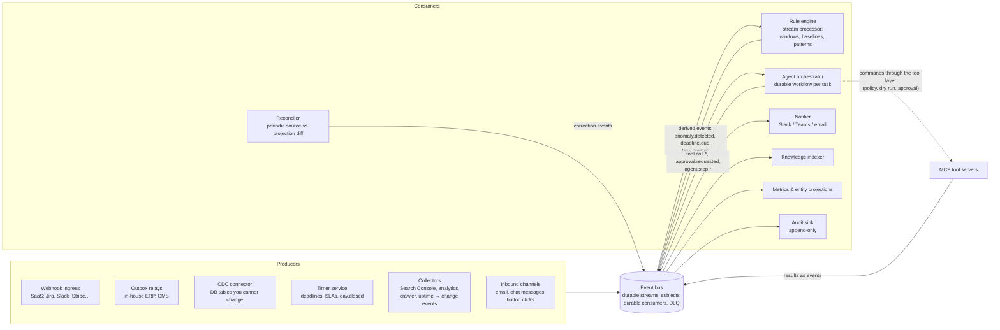

# 9. Event and messaging backbone

This document replaces the "scheduler and event bus" box of [doc 02](02-architecture.md)
with a proper design. The goal is a system that reacts to what happens in the company
within seconds, not at the next cron tick, and that does so reliably enough to take
work away from people.

The short version of the recommendation:

> **Events for latency, reconciliation for correctness, durable workflows for anything
> that waits.** Every change in a company system becomes an event on a durable bus.
> Rules, the agent, the notifier and the knowledge indexer are consumers of that bus.
> Time itself is just another producer (a timer service that emits "due" events).
> A small number of reconciliation sweeps remain, not to trigger work, but to catch
> whatever the event path missed.

---

## 9.1 Why cron is the wrong primary mechanism, and what remains of it

Cron-driven designs have three structural problems:

1. **Latency equals the schedule.** A noindex tag pushed at 10:05 is discovered the
   next morning at 07:30. The business cost accrues for 21 hours.
2. **Work is done whether or not anything changed.** Collectors run, diff, and mostly
   find nothing. Load is constant, information is sparse.
3. **Causality is lost.** A cron job sees a state, not a change. "Clicks are down" is
   a state; "a deployment changed the robots meta and clicks fell two days later" is a
   chain of events. The second is what a person needs.

What does *not* go away:

- **Time-based obligations** (a VAT return due on the 20th) are inherently about time.
  In an event system they are handled by a **timer service** that schedules a durable
  timer when the obligation is created and emits `deadline.reminder.due` when it fires.
  The rule engine consumes that event like any other. No consumer "polls the calendar".
- **Sources that cannot push.** Google Search Console has a two-day lag and no webhook.
  A collector still fetches it, but it fetches on an event (`day.closed` from the timer
  service), diffs against the last snapshot, and **publishes only changes**
  (`seo.metric.collected` per page). Downstream nothing knows or cares that a poll was
  involved.
- **Reconciliation.** Webhooks get lost, consumers crash mid-batch, a partner replays
  a day of events. A nightly or hourly job compares the source system with the
  projection the assistant holds and publishes correction events for the differences.
  This is cron used for correctness, and it is cheap, because it only emits deltas.

Rule of thumb: if a job's output is a *trigger*, convert it to an event. If its output
is a *comparison*, keep it periodic.

## 9.2 Vocabulary

| Term | Meaning here |
|------|--------------|
| **Event** | An immutable fact that something happened: `erp.invoice.posted`. Past tense. Producers do not know who listens. |
| **Command** | A request that something be done: `cmd.cms.remove_noindex`. Imperative. Exactly one handler. The assistant emits commands only through the tool layer, so policy always applies. |
| **Subject / topic** | The routing name of an event, hierarchical: `seo.metric.collected`. Consumers subscribe with wildcards: `seo.>`. |
| **Stream** | Durable, ordered log of events for a set of subjects, retained for days or weeks so consumers can replay. |
| **Durable consumer** | A named subscription whose position in the stream is stored server-side. If the consumer process dies and restarts, it continues where it left off. |
| **Ack / nak / redelivery** | A consumer acknowledges an event after processing it. No ack within the ack window means redelivery. A nak asks for redelivery after a delay. |
| **Dead-letter queue (DLQ)** | Where an event goes after N failed deliveries. Nothing is silently dropped; a person or a replay tool decides. |
| **Idempotency key** | A value that identifies the business occurrence (`invoice:INV-0912:posted`). Consumers remember processed keys and skip duplicates, which makes at-least-once delivery safe. |
| **Partition key** | The value events are ordered by (page path, order id). Events with the same key are processed in order; different keys in parallel. |
| **Outbox** | A table in a producer's own database where it writes the event in the same transaction as the business change. A relay publishes from the outbox to the bus. This is how a system never loses an event and never publishes one for a rolled-back change. |
| **CDC** | Change data capture: reading a database's write-ahead log and turning row changes into events. The way to get events from an in-house system you cannot or will not change. |
| **Correlation id** | Shared by every event in one causal chain (deployment → diff → anomaly → task → approval). Makes the chain traceable. |
| **Causation id** | The id of the event that directly caused this one. |

## 9.3 Target architecture



Three layers of events flow through the same bus:

1. **Domain events** – facts from company systems (`erp.invoice.posted`, `cms.page.published`, `ticket.created`, `tls.certificate.observed`).
2. **Derived events** – what the rule engine concludes (`seo.anomaly.detected`, `deadline.reminder.due`, `order.stuck.detected`, `task.created`).
3. **Operational events** – what the assistant itself does (`agent.step.completed`, `tool.call.completed`, `approval.requested`, `approval.decided`, `notification.sent`).

Because the assistant's own actions are events, the audit log is a projection of the
bus, the console's live view is a subscription, and the learning loop can replay a
week of operation to test a new rule.

## 9.4 The event envelope

Use [CloudEvents 1.0](https://cloudevents.io) as the envelope and add a few company
extensions. Full example in [`examples/events/envelope-cms-page-published.json`](../examples/events/envelope-cms-page-published.json).

```json
{
  "specversion": "1.0",
  "id": "01J9Z4K7Q2R6M8W3V1T5N0P9X2",
  "type": "cms.page.published",
  "source": "/cms/prod",
  "subject": "/pricing",
  "time": "2026-10-13T10:05:12Z",
  "datacontenttype": "application/json",
  "dataschema": "https://schemas.example.internal/cms.page.published/v2.json",
  "idempotencykey": "cms:page:/pricing:rev:4812",
  "partitionkey": "/pricing",
  "correlationid": "01J9Z4K7Q2R6M8W3V1T5N0P9X2",
  "causationid": null,
  "actor": "user:k.nagy",
  "pii": "none",
  "data": { "path": "/pricing", "revision": 4812, "changed_fields": ["template", "robots"], "robots": "noindex,follow", "deployment_id": "dep-2210" }
}
```

Rules:

- `type` is `<domain>.<entity>.<past-tense verb>`; versions live in `dataschema`, not in the type name. Breaking changes get a new schema version and both are produced for a transition period.
- `id` is a ULID (time-ordered, unique). `idempotencykey` is the business key. They are different things.
- `data` carries what happened, not the whole record. Consumers that need more call the tool layer (`cms.get_page`) with the ids in the event. This keeps events small and avoids leaking data to consumers that should not see it.
- Schemas are JSON Schema files in git (`schemas/<type>/vN.json`). Producers validate on publish; the bus rejects unknown types in production.

## 9.5 Subject taxonomy and catalogue

The catalogue is a file in git ([`examples/events/topics.yaml`](../examples/events/topics.yaml)): for each type the producer, the partition key, retention, the consumers, and the schema. The console renders it. A sample:

| Type | Producer | Key | Consumers |
|------|----------|-----|-----------|
| `erp.invoice.posted` / `.paid` / `.overdue` | ERP outbox | invoice_id | rule engine, metrics, timer service (schedules reminder timers) |
| `erp.order.status_changed` | ERP CDC | order_id | rule engine (stuck orders), metrics |
| `cms.page.published` | CMS outbox | path | rule engine (deploy + meta patterns), collector (immediate crawl) |
| `crawl.page.changed` | crawler collector | path | rule engine |
| `seo.metric.collected` | Search Console collector | path | rule engine (baselines), metrics |
| `uptime.check.failed` / `.recovered` | uptime webhook | site | rule engine |
| `tls.certificate.observed` | TLS collector | host | timer service (re-arms expiry timer), rule engine |
| `ticket.created` / `.commented` / `.resolved` | Jira webhook | ticket_id | rule engine (SLA timers), knowledge indexer |
| `kb.document.changed` | source connectors | document_id | knowledge indexer |
| `deadline.reminder.due` / `deadline.overdue` | timer service | deadline_id | rule engine |
| `seo.anomaly.detected`, `order.stuck.detected`, … | rule engine | entity key | orchestrator, notifier, audit |
| `task.created` / `.acknowledged` / `.resolved` | rule engine / console / orchestrator | task_id | orchestrator, notifier, metrics |
| `approval.requested` / `approval.decided` | guardrails / console / Slack button | approval_id | orchestrator (waits on it), notifier, audit |
| `tool.call.completed` / `.failed` | tool gateway | call_id | audit, orchestrator, metrics |
| `agent.step.completed` | orchestrator | task_id | audit, console live view |
| `producer.heartbeat` | every producer, every minute | producer | liveness monitor |

## 9.6 Producers: how to get events out of each kind of system

| Situation | Mechanism | Notes |
|-----------|-----------|-------|
| In-house app you can change (ERP, CMS) | **Transactional outbox** + relay | Write the event row in the same DB transaction as the change. A relay (Debezium outbox connector, or a 20-line loop) publishes and marks sent. Zero lost events, zero phantom events. |
| In-house app you cannot change, but you have the DB | **CDC** (Debezium on Postgres/MySQL/SQL Server) | Row changes become events. Add a thin "translator" consumer that turns `orders.row.updated` into `erp.order.status_changed` with business meaning. |
| SaaS with webhooks (Jira, Slack, Stripe, GitHub, uptime monitors) | **Webhook ingress service** | One public endpoint per source. Verifies signatures, deduplicates by delivery id, normalises to the envelope, publishes, returns 200 fast. Never processes inline. |
| SaaS without webhooks (Search Console, many analytics APIs, Ahrefs) | **Collector** triggered by an event (`day.closed`, `cms.page.published`) | Fetches, diffs with the last snapshot, publishes **changes only**. Emits `producer.heartbeat` so silence is detectable. |
| Files on a share | File watcher (inotify / SMB change notify) → `kb.document.changed` | Fall back to a periodic listing diff if notifications are unreliable. |
| Email, chat | Inbound gateway → `message.received` | The agent can be addressed by people as well as by systems. |
| Time | **Timer service** | Durable timers stored in Postgres or in the workflow engine. Created by events (`erp.invoice.posted` → reminder timer at +21 days; `deadline.created` → lead-time timers). Emits `deadline.reminder.due`. Cancelled by events (`erp.invoice.paid`). |
| Human actions in Slack/Teams/console | Buttons and commands → `approval.decided`, `task.acknowledged` | Humans are producers too. The orchestrator waits on these events instead of polling a table. |

## 9.7 Consumers

### Rule engine as a stream processor

The rule engine from [doc 04](04-rule-system.md) becomes a consumer with per-key state:

- **Threshold rules**: maintain the baseline per key (page) incrementally; on each
  `seo.metric.collected` compute the ratio and the consecutive-breach counter; emit
  `seo.anomaly.detected` when the condition is met, `seo.anomaly.cleared` when it clears.
- **Pattern rules** (new, and the real win of events): "`cms.page.published` with
  `robots` in `changed_fields` on a key page" fires **immediately**, before any traffic
  is lost. "`cms.page.published` followed within 48 h by `seo.metric.collected` with
  ratio < 0.8 on the same key" produces an anomaly with the cause already attached.
  "`uptime.check.failed` three times within 5 minutes" opens an incident.
- **State rules**: on `erp.order.status_changed` to `awaiting_payment`, ask the timer
  service for a timer at +7 days keyed by the order; on `.paid` cancel it; on the
  timer's `deadline.reminder.due` emit `order.stuck.detected`. No periodic scan.
- **Time rules**: are timers plus an escalation chain, handled the same way.

Implementation options: a plain Python/Go consumer with state in Postgres (enough for
hundreds of events per second), or Kafka Streams / Flink if volume is high. Start plain.

### Agent orchestrator as durable workflows

Every `task.created` starts a **durable workflow** (Temporal is the recommendation; the
Claude Agent SDK runs inside its activities). A workflow:

- executes the playbook step by step, each step an idempotent activity (a tool call, an LLM call);
- **waits on events** rather than polling: `approval.decided`, `task.acknowledged`, a
  timer for the escalation deadline;
- survives process restarts and deploys mid-task, with the history intact;
- emits `agent.step.completed` after each step so the console shows live progress;
- has a hard timeout and a compensation path (what to undo or tell a human if it fails).

This is what makes "the assistant handles it" reliable: the task cannot be forgotten
half-way, and every wait is explicit.

### Other consumers

- **Notifier**: renders events into channel messages, respects quiet hours and
  per-person preferences, deduplicates (one message per task, updated in place), and
  publishes `notification.sent` / `notification.failed`.
- **Knowledge indexer**: consumes `kb.document.changed` and `ticket.resolved` (resolutions are knowledge) and re-indexes incrementally.
- **Projections**: metrics store, entity store and the console's read models are built
  from the stream and can be **rebuilt by replay**.
- **Audit sink**: writes every event to an append-only store; the audit log is this projection.
- **Liveness monitor**: consumes `producer.heartbeat`; emits `producer.silent` when a
  source has not been heard from inside its expected interval. This is the dead-man
  switch that cron systems lack: with cron, a collector that silently fails simply
  produces no alerts, which looks like good news.

## 9.8 Reliability: the decisions that matter

These are the choices that separate a demo from a system people can rely on.

1. **At-least-once delivery plus idempotent consumers.** Do not chase exactly-once; it
   does not survive contact with external systems. Every consumer keeps a table of
   processed `idempotencykey`s (with TTL) and skips repeats. Every write tool takes an
   idempotency key. The result is *effectively once*.
2. **Outbox on the producer side.** Business change and event in one transaction. No
   dual-write bugs.
3. **Ordering only where needed, by key.** Order events are ordered per order id,
   page events per path. Do not demand global ordering; it kills throughput and
   availability.
4. **Explicit ack with a bounded ack window, retries with exponential backoff and
   jitter, then DLQ.** Typical: 5 attempts over about 10 minutes, then dead-letter.
   The DLQ has an owner, an alert and a replay button (the console shows it).
5. **Poison-message isolation.** One malformed event must not block a partition.
   Validate against the schema on ingress; DLQ immediately on validation failure.
6. **Durable timers, not sleeping processes.** A reminder in 21 days survives
   restarts only if it is stored. Use the workflow engine's timers or a timer table
   with a leader-elected scheduler.
7. **Retention long enough to replay.** Keep domain events 30 days or more, derived
   and operational events 7 to 30 days. Replay is how you rebuild a projection,
   backfill a new rule, or test a change against real history.
8. **Schema evolution is additive.** New optional fields are fine; renaming or
   removing needs a new schema version and a transition window.
9. **Backpressure.** Consumers pull at their own pace (JetStream pull consumers, Kafka
   consumer groups). A slow LLM step must not make the webhook ingress return 500s.
10. **Reconciliation.** Hourly for money and deadlines, daily for the rest: compare
    the source of truth with the projection and publish corrections. Alert when the
    correction rate rises; it means events are being lost upstream.
11. **Observability by correlation id.** One trace from webhook receipt to Slack
    message. Dashboards: events per type per minute, consumer lag, DLQ depth,
    end-to-end latency p50/p95, producer silence.
12. **Kill switch and canary.** One flag pauses every consumer that performs actions
    (the orchestrator and notifier) while observation consumers keep running. New rule
    versions run as **shadow consumers** on the same stream before they replace the live one.
13. **Clock discipline.** All times UTC in events; business time zones applied only at
    the edges (timer creation, message rendering). Reject events with timestamps too far in the future.
14. **Security.** Signed webhooks, mTLS between services, per-consumer credentials,
    events carry ids not payloads for sensitive data, PII flags drive retention.

Target service levels to write down and measure:

| Metric | Target |
|--------|--------|
| Event ingress to rule decision | p95 < 5 s |
| Event ingress to first notification | p95 < 60 s |
| Lost events found by reconciliation | < 0.1 % of events, trending down |
| DLQ depth | 0 at end of each business day |
| Producer silence detection | within 2 × expected interval |

## 9.9 Technology recommendation

| Need | Recommended | Alternatives | Why |
|------|-------------|--------------|-----|
| Event bus | **NATS JetStream** | Redpanda / Apache Kafka, RabbitMQ Streams, cloud (Pub/Sub, SNS+SQS, Event Grid) | Single binary, subjects with wildcards, durable pull consumers, per-message ack, DLQ via max-deliver advisories, replay by time or sequence. Fits a mid-size company with a small team. Choose Kafka/Redpanda if you already run it, expect > 10k events/s, or want the Debezium and Flink ecosystem natively. |
| Durable workflows | **Temporal** (self-hosted or cloud) | Restate, AWS Step Functions, Inngest | Durable timers, signals (events the workflow waits on), retries, full history per task. The agent runtime runs inside activities. |
| CDC and outbox relay | **Debezium** | pgoutput custom relay, Redpanda Connect | Mature connectors for Postgres, MySQL, SQL Server, Oracle; outbox event router built in. |
| Webhook ingress | Small own service (FastAPI/NestJS) | Svix, Hookdeck | Needs signature verification, dedupe, normalisation, fast 200. |
| Schema registry | JSON Schema in git + CI validation | Confluent Schema Registry, Apicurio | Start simple; move to a registry if producers multiply. |
| Stream processing | Plain consumers + Postgres state | Kafka Streams, Flink, Bytewax | Volume here is low; clarity beats machinery. |
| Observability | OpenTelemetry → Grafana Tempo/Loki/Prometheus | Datadog, Honeycomb | Correlation id as trace id. |

A minimal production footprint: NATS JetStream (3 nodes), Temporal (server + Postgres),
Postgres (projections, timers, idempotency tables), the webhook ingress, the rule
engine, the orchestrator, the notifier, the indexer, and the console. All containers.

## 9.10 Migrating the current schedules

| Today (cron) | Event-driven replacement | What stays periodic |
|--------------|--------------------------|---------------------|
| Daily SEO collection 07:00 | `day.closed` event from the timer service triggers the collector; collector publishes `seo.metric.collected` per changed page | the collector run itself (source has no push); frequency can rise to hourly for fresh analytics |
| Daily key-page crawl and diff 07:30 | `cms.page.published` triggers an immediate crawl of the touched pages; `crawl.page.changed` published within seconds | a daily full crawl as reconciliation |
| Deadline sweep weekdays 08:00 | timer service: one durable timer per deadline and lead time; `deadline.reminder.due` | a daily reconciliation that compares deadlines in the entity store with timers |
| Knowledge base reconciliation 02:00 | connectors emit `kb.document.changed` on change (SharePoint/Drive/Confluence webhooks, file watcher) | a nightly full listing diff |
| Weekly lessons review | triggered by `task.resolved` counts crossing a threshold, or on demand | a weekly summary digest |
| ERP orders poller every 15 min | CDC on the orders table → `erp.order.status_changed`; stuck-order timers | hourly reconciliation of order statuses |
| Uptime poller every minute | the uptime monitor's own webhook → `uptime.check.failed` | none |

## 9.11 How this gets the assistant to take over work safely

Events make the assistant fast. Taking over human work also needs it to be **precise
and accountable**, and the event design helps there too:

- **Every decision has evidence attached.** The anomaly event carries the metric, the
  baseline, the deployment that preceded it and the diff. The agent explains from
  evidence, not from guesswork.
- **Every action is an event with a correlation chain.** When a person asks "why did
  the assistant do that", the answer is a replayable chain.
- **Autonomy is promoted per (playbook, action) from measured outcomes.** The ladder
  from [doc 06](06-learning-loop.md) is computed from `approval.decided` and
  `task.resolved` events: approval rate, correction rate, time to resolution. A pair
  moves to "auto" only when the numbers say so, and demotes automatically on a
  correction event.
- **Shadow before live.** A new rule or playbook version consumes the same stream and
  emits to a `shadow.*` subject. Its would-be actions are compared with what happened.
- **Humans stay in the loop as producers, not as pollers.** An approval is a button
  click that becomes an event; nobody has to remember to check a queue, because the
  orchestrator escalates on a timer if the event does not arrive.
- **Define "replace" per task, with an exit condition.** For each process from the
  discovery inventory: the metric that proves the assistant does it well (missed
  deadlines, time to detect, error rate), the autonomy level required, and the person
  who remains accountable. Processes reach level 4 (auto, silent) one at a time.

## 9.12 Honest limits

- "Real time" means seconds from the source event. Sources with inherent lag (Search
  Console: about two days) stay lagged; the design only removes the lag *you* add.
- Some SaaS tools have no webhooks and tight API quotas; their collectors remain
  periodic. Make them event-triggered and change-only, and accept the floor.
- Event systems move complexity from "when does it run" to "what happens when it
  runs twice, late, or out of order". The reliability list above is not optional.
- A durable workflow engine is a new component to operate. It pays for itself the
  first time a deploy happens while twenty tasks are mid-flight.
